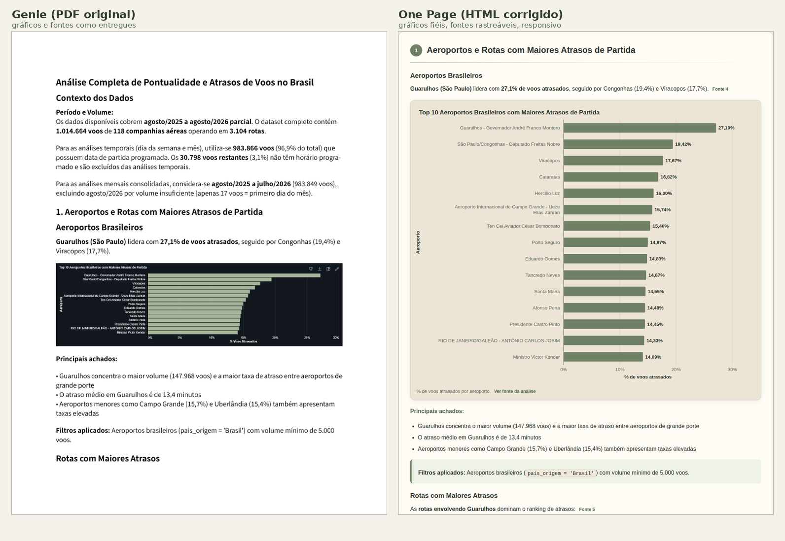

# 🛠️ Construção do One Page e ajustes encontrados

Esta exploração complementar nasceu da intenção de melhorar a apresentação da saída do Genie. A demonstração utiliza as entradas da execução 03; a execução 04 permanece como resultado principal da etapa Genie.

## 💡 O que o processo ensinou

1. **Redação:** orientações específicas, como evitar “progressivo” quando os dados apresentam oscilações, ajudaram a reduzir afirmações que as tabelas contradiziam.
2. **Escopo:** explicitar o período, os meses parciais e as bases de cálculo evitou comparar totais obtidos com filtros diferentes.
3. **Apresentação:** foi necessário definir prioridade entre fontes, fidelidade dos gráficos, organização das fontes e critérios para conferir o resultado.

## 📄 Materiais utilizados

| Material | Papel |
|---|---|
| [Entradas da execução 03](../entradas/execucao-03/) | PDF de conteúdo, Response com SQL/resultados, CSVs e PNGs |
| [Prompts da análise](../entradas/execucao-03/prompts-analise.txt) | Instruções que originaram os resultados da execução 03 |
| [Prompt do One Page](../prompts/prompt-one-page.txt) | Solicitação de transformação e apresentação |
| [Exemplo visual](https://dinalima1610.github.io/alura-imersao-ai-engenharia-dados/voebem-analytics-databricks/06-relatorio-one-page/referencia-visual/exemplo-one-page.html) | Referência de aparência; seus números e textos pertencem ao exemplo |
| [Relatório final](https://dinalima1610.github.io/alura-imersao-ai-engenharia-dados/voebem-analytics-databricks/06-relatorio-one-page/relatorio/index.html) | Demonstração de apresentação baseada na execução 03 |

## 🔎 Revisão do resultado

**Pergunta:** o relatório HTML One Page, gerado por uma IA a partir do PDF do Genie, dos resultados SQL e de um prompt, foi fiel ao que se pediu?

**Método:** comparar, item a item, o prompt, o PDF e o HTML — estrutura (parsing e renderização em celular, tablet e desktop), gráficos (figuras originais × SVG), rastreabilidade (grupos de fonte × `Sources`) e números (texto × resultados).

## ✅ O que funcionou

Tema claro/escuro, links internos, grupos recolhíveis fechados, rodapé, ausência de dependências externas e estrutura geral seguiam o pedido.

## 🛠️ Falhas de execução

1. **Gráficos infiéis.** Barras viraram linhas; séries inexistentes foram acrescentadas no mesmo eixo; o gráfico do Top 10 mostrava 10 barras quando a figura original tem 15; a barra negativa de Guarulhos sumiu; a linha "Média geral" foi omitida.
2. **Tabelas e listas fora do padrão.** Listas numeradas viraram tabelas; apareceram tabelas que o PDF não tem.
3. **Rastreabilidade quebrada.** Uma fonte recebeu trecho da consulta de outra; resultados saíram como texto cru de Markdown; sobraram marcadores soltos ("Source:", números).
4. **Texto inventado ou meta.** Resumo e subtítulo narravam o processo de geração.
5. **Responsividade.** Texto dos gráficos com ~9 px efetivos no celular e rolagem horizontal.

## 📝 Falhas do prompt

- Sem regra de desempate quando PDF, TXT, PNG e CSV divergem.
- "Reconstrua o gráfico" sem definir fidelidade (tipo, séries, eixos, categorias).
- Sem mapeamento figura → saída, o que misturava tabelas reais, tabelas-imagem e listas.
- Resumo Executivo sem especificação de conteúdo.
- Formato dos grupos de fonte e fronteira entre fontes indefinidos.
- Critérios de teste não verificáveis ("sem rótulos cortados" sem viewport nem tamanho mínimo).
- Nada dizia o que fazer ao encontrar erro no conteúdo de origem.

## 🔍 Inconsistências no conteúdo gerado pelo Genie

Verificadas contra os resultados do próprio relatório (detalhes em [`notas_consistencia.json`](../notas_consistencia.json)):

- "+4,8 p.p." de vantagem da Copa sobre a 2ª colocada: o resultado dá 3,8 p.p.
- Dezembro "quase o dobro da média" e "99% acima": os dados dão cerca de +65%.
- "2,8x" o atraso médio dos outros meses: o cálculo dá ~2,2x.
- "5h–7h com 8–9% de atraso": às 7h o atraso é 13,6%.
- "Crescem continuamente": há queda entre 19h e 21h.
- Corte de 10.000 voos com a LATAM (13.957 voos) classificada como baixo volume.
- Recomendação de "janela de 2–3 horas" sem respaldo em nenhuma consulta.

## 🔧 Correção

O [gerador](../) lê os arquivos de origem e deriva **todas** as quantidades (seções, fontes, gráficos, tabelas, linhas, categorias):

- Tipo do gráfico e coluna plotada são **inferidos pela geometria do PNG original** (medidas de barras ou pontos comparadas com as colunas do resultado SQL), sem depender de OCR.
- Cada fonte recebe apenas o seu SQL e o seu resultado (associação por título; ou por SQL idêntico à consulta do relatório).
- Citações numéricas do Response viram links discretos para a fonte.
- Cada gráfico tem três layouts (celular, tablet, desktop).
- Inspeção por script: medições de rótulos cortados e sobrepostos, tamanho efetivo da fonte, rolagem horizontal e abertura das fontes. O utilitário apresenta os resultados para conferência; não emite uma aprovação automática. A cobertura do texto do PDF exige uma verificação separada e não é calculada pela execução padrão do script.

## 📊 Resultado

Mesmo conteúdo do PDF, com gráficos fiéis, rastreabilidade completa e as observações de consistência registradas em um bloco recolhível. Ver o [relatório de apresentação](https://dinalima1610.github.io/alura-imersao-ai-engenharia-dados/voebem-analytics-databricks/06-relatorio-one-page/relatorio/index.html).