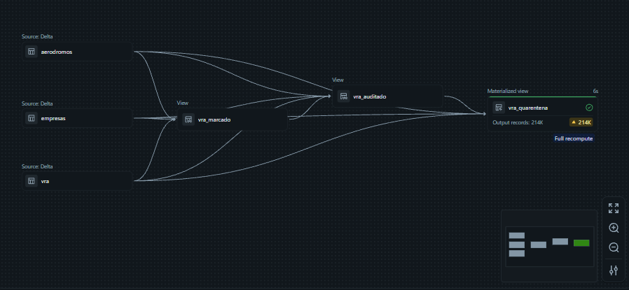
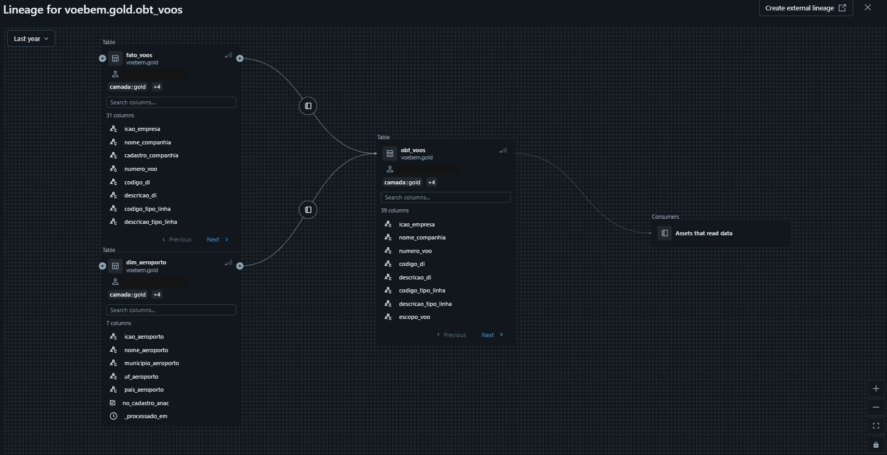

# 🏗️ Arquitetura e decisões de modelagem

Resumo da arquitetura trabalhada na imersão, escrito com as minhas palavras. O código-base (Bronze/Silver/Gold) pertence ao material da turma e não está neste repositório.

## 🗃️ Camadas (Arquitetura Medalhão)

| Camada | Papel | Exemplos de objetos |
|---|---|---|
| **Bronze** | Ingestão fiel dos arquivos da ANAC, sem interpretar | `voebem.bronze.vra` e tabelas de referência (aeródromos, empresas) |
| **Silver** | Espelho governado do Bronze: tipagem, nomes padronizados, metadados e unificação dos cadastros | `voebem.silver.vra` |
| **Qualidade** | Pipeline declarativo em três etapas: dados *marcados*, *auditados* e em *quarentena* | `vra_marcado` → `vra_auditado` → `vra_quarentena` (9 expectativas definidas) |
| **Gold** | Modelo analítico para consumo | `dim_aeroporto`, `fato_voos`, `obt_voos` (*One Big Table*) |

Catálogo `voebem`, com os esquemas `bronze`, `silver` e `gold`; os arquivos chegam por um *Volume* do Unity Catalog.

## 💡 Decisões que valem ser explicadas

- **Silver sem regra de negócio.** A Silver mantém o mesmo grão e a mesma contagem do Bronze. Subtrair horários (atraso em minutos) é aritmética e cabe na Silver; definir "pontual = atraso ≤ 15 min" embute uma decisão de negócio que muda por cliente e fica na Gold. Filtrar na Silver fecha portas: cada linha descartada é uma pergunta que ninguém poderá fazer depois.
- **Gold em *One Big Table* para consumo por IA.** Uma linha por etapa de voo, com nomes de companhia e de aeroporto (com município e UF) já resolvidos. A regra é não haver coluna de código sem a descrição ao lado, porque nomes e descrições explícitos facilitam a interpretação pelo modelo e reduzem ambiguidades em relação aos códigos ICAO. Quem consome não precisa de nenhum *join*.
- **"Por quê" medido, não declarado.** A coluna de justificativa do VRA vem sem informação desde 2020; por isso a análise explica atrasos por fatores medidos (hora do dia, dia da semana, tipo de linha, aeroporto, companhia).
- **Qualidade como etapa explícita.** O pipeline declarativo marca, audita e isola em quarentena os registros que violam regras de negócio (por exemplo, códigos ICAO vazios), e registra eventos de qualidade que podem ser consultados depois.

## 🔗 Linhagem

`dim_aeroporto` e `fato_voos` alimentam `obt_voos`, que é a única tabela exposta ao Genie.
